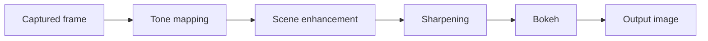

# iOS Imaging Pipeline

An on-device computational photography app for iPhone. It captures a frame, scores its sharpness, and runs it through a chain of classical image-processing stages (sharpening, portrait-style background blur, tone mapping, scene enhancement) using Apple's Vision, Core Image, and AVFoundation frameworks. No deep learning models are involved.

The UI is React Native; all image processing is in native Swift modules exposed to JavaScript through the React Native bridge. A write-up with methods and discussion is in the [project report](./SreshthTiwari_Report.pdf).

| App | Input | Output (full pipeline) |
| :---: | :---: | :---: |
|  |  |  |

## What it does

| Stage | Technique | Apple APIs |
| --- | --- | --- |
| Blur analysis | Variance of a 4-neighbour Laplacian on the grayscale image; low variance means blurry (threshold 150) | CoreVideo pixel buffers |
| Sharpening | Luminance sharpening | Core Image (`CISharpenLuminance`) |
| Portrait bokeh | Person segmentation matte, Gaussian-blurred background, composited with the matte | Vision (`VNGeneratePersonSegmentationRequest`), Core Image |
| Tone mapping | Exposure shift, shadow/highlight recovery, contrast | Core Image (`CIExposureAdjust`, `CIHighlightShadowAdjust`, `CIColorControls`) |
| Scene enhancement | Exposure, vibrance, contrast | Core Image (`CIVibrance`, `CIColorControls`) |
| Camera capture | Live preview and still frame capture | AVFoundation |

Each stage can be run on its own from the UI, or all together with **Run Pipeline**, which applies them in this order:



## Architecture

```
App/
├── App.tsx, index.js            React Native entry point
├── src/
│   ├── screens/CameraScreen.tsx  UI and orchestration
│   ├── components/               Button, side-by-side compare, fullscreen viewer
│   └── native/*Bridge.ts         Typed JS wrappers over each native module
├── __tests__/                    Jest tests for the JS bridge layer
└── ios/ComputationalPortraitApp/
    └── Modules/                  Swift modules + Objective-C bridge declarations
        ├── CameraModel           AVFoundation capture session
        ├── BlurMetricsModule     Laplacian-variance sharpness score
        ├── ProcessingModule      Sharpening
        ├── BokehModule           Vision segmentation + compositing
        ├── ToneMappingModule
        ├── SceneEnhancementModule
        └── MotionDeblur          Blur estimate + sharpening-based "deblur" (sharpen + unsharp mask)
```

Each native module is a Swift class marked `@objc`, registered with a small `.m` file using `RCT_EXTERN_MODULE`, and called from the matching `src/native/*Bridge.ts` as a promise.

## Running it

Requires macOS, Xcode, Node 22.11 or newer, and Ruby (for CocoaPods). The app is iOS only; the camera and Vision features need a real device for full behavior.

```sh
cd App
npm install
bundle install
bundle exec pod install --project-directory=ios
npm start            # Metro bundler, in its own terminal
npm run ios          # build and launch
```

To run on a physical iPhone, open `App/ios/ComputationalPortraitApp.xcworkspace` in Xcode, select your development team under Signing & Capabilities, and run.

### Tests and checks

```sh
cd App
npm test             # Jest: bridge layer and pipeline ordering
npx tsc --noEmit     # type check
npm run lint
```

## Limitations

- **"Motion deblur" is sharpening, not deconvolution.** It estimates blur with the Laplacian metric and applies sharpening filters. It does not estimate a blur kernel or invert it. The report discusses this.
- **Bokeh uses a uniform Gaussian blur** behind a segmentation matte, so quality depends on the matte and there is no depth-dependent falloff.
- **Tone mapping and scene enhancement use fixed parameters.** They are not adaptive to image content.
- **The pipeline renders through intermediate JPEGs.** Each stage saves a temporary file that the next stage reloads. A native single-pass `PipelineModule` exists in `Modules/` but is not yet registered in the Xcode target, so the app currently uses the JS fallback in `PipelineBridge.ts`.
- No quantitative benchmarks yet; results in the report are qualitative.
