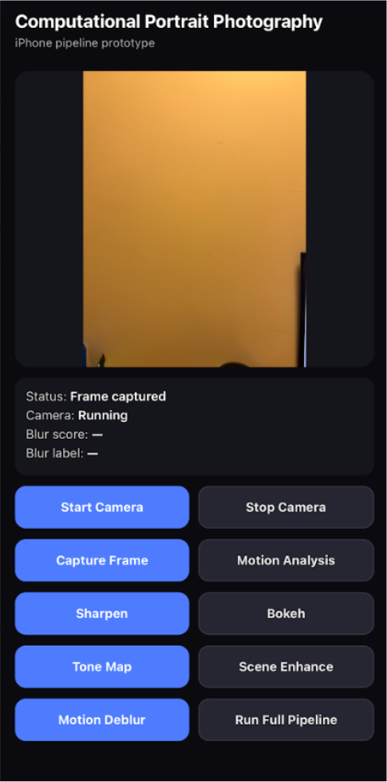
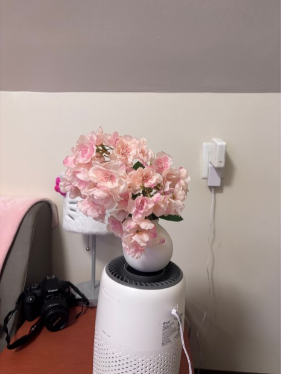
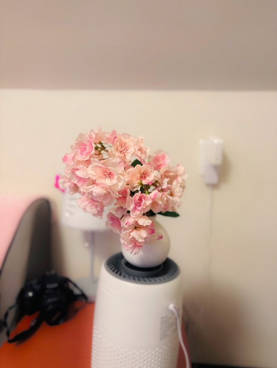

# iOS Imaging Pipeline

An on-device computational photography app for iPhone. It captures a frame, scores its sharpness, and runs it through a chain of classical image-processing stages (sharpening, portrait-style background blur, tone mapping, scene enhancement) using Apple's Vision, Core Image, and AVFoundation frameworks. No deep learning models are involved.

The UI is React Native; all image processing is in native Swift modules exposed to JavaScript through the React Native bridge. A write-up with methods and discussion is in the [project report](./SreshthTiwari_Report.pdf).

| App | Input | Output (full pipeline) |
| :---: | :---: | :---: |
|  |  |  |

## What it does

| Stage | Technique | Apple APIs |
| --- | --- | --- |
| Blur analysis | Variance of a 4-neighbour Laplacian on the grayscale image, computed at a fixed 1024 px scale so scores are comparable across resolutions; below 150 is labelled blurry | Accelerate (vImage, vDSP) |
| Sharpening | Luminance sharpening | Core Image (`CISharpenLuminance`) |
| Portrait bokeh | Person segmentation matte, Gaussian-blurred background, composited with the matte; skipped when no person is found | Vision (`VNGeneratePersonSegmentationRequest`), Core Image |
| Tone mapping | Exposure shift, shadow/highlight recovery, contrast | Core Image (`CIExposureAdjust`, `CIHighlightShadowAdjust`, `CIColorControls`) |
| Scene enhancement | Exposure, vibrance, contrast | Core Image (`CIVibrance`, `CIColorControls`) |
| Motion deblur | Blind estimation of a linear blur kernel, then Wiener deconvolution (see below) | Accelerate (vDSP FFTs) |
| Camera capture | Live preview and still frame capture | AVFoundation |

Each stage can be run on its own from the UI, or all together with **Run Pipeline**, which applies them in this order and renders the whole chain **once** as a single Core Image graph (no intermediate files):


## Architecture

```
App/
├── App.tsx, index.js            React Native entry point
├── src/
│   ├── screens/CameraScreen.tsx  UI and orchestration
│   ├── components/               Button, side-by-side compare, fullscreen viewer
│   └── native/*Bridge.ts         Typed JS wrappers over each native module
├── __tests__/                    Jest tests for the JS bridge layer
└── ios/ComputationalPortraitApp/
    └── Modules/                  Swift modules + Objective-C bridge declarations
        ├── CameraModel           AVFoundation capture session
        ├── BlurMetricsModule     Laplacian-variance sharpness score
        ├── ImagingStages         The stage filters as lazy CIImage transforms (single source of truth)
        ├── ImagingIO             Shared CIContext, orientation-aware load, direct-to-JPEG write
        ├── SharpnessMetric       The one variance-of-Laplacian implementation
        ├── BlurDeconvolution     Kernel estimation, FFT Wiener deconvolution, noise estimate
        ├── PipelineModule        Full pipeline as one Core Image graph, rendered once
        ├── ProcessingModule      Sharpening
        ├── BokehModule           Vision segmentation + compositing
        ├── ToneMappingModule
        ├── SceneEnhancementModule
        └── MotionDeblur          React Native module over BlurDeconvolution
tools/pipeline-bench/             macOS harness: old chain vs single pass (timing + PSNR)
tools/blur-eval/                  macOS harness: sharpness metric calibration, deblur evaluation
```

Each native module is a Swift class marked `@objc`, registered with a small `.m` file using `RCT_EXTERN_MODULE`, and called from the matching `src/native/*Bridge.ts` as a promise. The filter parameters live only in `ImagingStages`; the per-stage modules and the full pipeline both call into it, so the buttons and the pipeline cannot drift apart.

### Single-pass pipeline

The first version rendered every stage to a `CGImage`, encoded a JPEG, wrote it to disk, and had the next stage reload it. Now `ImagingStages.fullPipeline` builds one lazy `CIImage` graph and `PipelineModule` renders it once, straight to a JPEG. Two details matter:

- **Each stage clamps to the 0 to 1 range.** The old chain clipped implicitly because every stage went through an 8-bit JPEG. A float graph keeps out-of-range values instead, and `CISharpenLuminance` produces enormous ones in near-black pixels (it scales colour by a luminance ratio). Unclamped, the later background blur smears them into coloured blobs.
- **Vision segments the source image, not the sharpened one.** Vision needs real pixels, so segmenting the end of the chain would force every earlier stage to render a second time. Person matting is insensitive to these mild tonal changes.

## Running it

Requires macOS, Xcode, Node 22.11 or newer, and Ruby (for CocoaPods). The app is iOS only; the camera and Vision features need a real device for full behavior.

```sh
cd App
npm install
bundle install
bundle exec pod install --project-directory=ios
npm start            # Metro bundler, in its own terminal
npm run ios          # build and launch
```

To run on a physical iPhone, open `App/ios/ComputationalPortraitApp.xcworkspace` in Xcode, select your development team under Signing & Capabilities, and run.

### Tests and checks

```sh
cd App
npm test             # Jest: bridge layer and pipeline ordering
npx tsc --noEmit     # type check
npm run lint
```

## Performance

Wall-clock time for the full pipeline, old stage-by-stage chain versus the single pass, measured with [`tools/pipeline-bench`](./tools/pipeline-bench/main.swift) (15 runs after 2 warm-ups, median):

| Input | Old chain | Single pass | Speedup | of which Vision | Temp data written |
| --- | --- | --- | --- | --- | --- |
| 0.3 MP, no person (bokeh skipped) | 43 ms | 35 ms | 1.2x | 32 ms | 271 KB → 77 KB |
| 5.1 MP portrait | 111 ms | 82 ms | 1.4x | 33 ms | 4.8 MB → 1.4 MB |
| 12 MP portrait (resized) | 200 ms | 115 ms | 1.7x | 57 ms | 9.2 MB → 2.8 MB |

The saving grows with resolution because it comes from removing the render, JPEG encode, disk write, and decode between stages; person segmentation costs the same either way. The single-pass output is visually identical to the old output. It differs from it by 32 to 38 dB PSNR, which is JPEG generation loss from the old chain plus small changes in Vision's matte (the old chain segmented the re-encoded image).

These are **Mac numbers, not iPhone numbers**: Apple M5, macOS 26, Core Image on Metal, same Swift stage code as the app. The 12 MP row is a 5 MP photo resized up, not a real 12 MP capture. On-device timings are still to be measured (the app now logs the pipeline time with `NSLog`). Reproduce with:

```sh
tools/pipeline-bench/run.sh path/to/photo.jpg --runs 15 [--megapixels 12]
```

## Motion deblur

The **Motion Deblur** button estimates a *uniform linear* blur kernel (a direction and a length, as from camera shake) and inverts it with a Wiener filter. It is classical signal processing on Accelerate FFTs, and it is deliberately conservative about when it acts.

1. **Kernel search.** For each candidate (angle, length), Wiener-deconvolve four textured 192 px windows and score the result with the normalised gradient sparsity `||g||1 / ||g||2` (Krishnan, Tay and Fergus, 2011). A sharper image has sparser gradients, and a real camera shake is the same in every window, which filters out minima caused by one patch of content. About 1,000 candidates are scored, then refined to sub-degree and sub-pixel steps.
2. **Acceptance.** The kernel is applied only if it is at least 8 px long, at least 10° away from horizontal and vertical, and beats the best *short* kernel (generic sharpening) by 2%. The image must also be low-noise. Otherwise the image is returned untouched and the UI says so.
3. **Restoration.** Tiled overlap-save Wiener deconvolution on each RGB channel (1024 px FFT tiles with mirrored borders, so memory stays bounded). The regularisation scales with a robust per-image noise estimate.

### How well it works

Measured by blurring sharp photos with a known kernel (built by averaging sub-pixel-shifted copies, independently of the deconvolution code) and comparing the result to the original, with `tools/blur-eval`. Gain is PSNR improvement over the blurred input when the deblur was applied:

| Test set | Noise σ | Applied | Helped (>0.5 dB) | Hurt (<-0.3 dB) | Mean gain | Unblurred images touched |
| --- | --- | --- | --- | --- | --- | --- |
| In-sample: 8 images × 7 blurs | 0.004 | 22 of 56 | 22 | 0 | +3.3 dB | 0 of 8 |
| Held-out: 12 images × 6 unseen blurs | 0.004 | 35 of 72 | 34 | 1 | +2.6 dB | 0 of 12 |
| Held-out | 0.01 | 35 of 72 | 30 | 3 | +1.4 dB | 0 of 12 |
| Held-out | 0.02 | 0 of 72 | n/a | n/a | n/a | 0 of 12 |

With the *true* kernel the same Wiener restoration gains roughly 4 dB, so when the kernel is found the result is close to what this method can achieve.

What this does **not** do, honestly:

- **It declines about half of real blurs.** Horizontal and vertical blur is rejected on purpose: in testing, wrong estimates clustered at the image axes (the pixel grid, JPEG blocking and strong horizontal and vertical edges all create false minima there), and a wrong long kernel can wreck a sharp photo. Letting them through gave 14 harmful results in 56 cases and one image losing 31 dB. The acceptance rules were chosen after looking at the first image set, which is why the held-out set exists.
- **Only uniform linear blur.** Not rotation, non-uniform shake, moving subjects against a still background, or defocus.
- **Test data is limited.** The tests use crops of two photographs with synthetic blur and synthetic noise; they are not a benchmark on real handheld shots. Real camera noise is not white, so the noise cutoff may need re-tuning.
- **It rings near strong edges and amplifies noise**, as any linear deconvolution does.
- **Cost:** about 0.3 s at 5 MP and 0.45 s at 12 MP on an M5 Mac (kernel search ~160 ms regardless of size, restoration scales with pixels). Peak memory is roughly 30 bytes per pixel, so a 12 MP photo needs a few hundred MB. Not yet measured on an iPhone.

Reproduce with `tools/blur-eval/run.sh evaluate <images> [--noise S] [--cases angle/length,...]`.

## Limitations

- **The report predates the deblur.** It says true motion deblurring is not implemented and that blur analysis is a plain sharpness score; both are now out of date.
- **The blur label is content dependent.** Variance of Laplacian is low for any smooth scene, so a sharp photo of a plain wall can read "blurry". The 150 threshold was set against Gaussian blur on one portrait (about 1 px of blur at 1600 px), not against a dataset of real photos.
- **Tone mapping and scene enhancement use fixed parameters.** They are not adaptive to image content.
- **Bokeh needs a person.** When Vision's matte covers under 1% of the frame, the pipeline skips bokeh (the Bokeh button reports "No person found"). It still uses a uniform blur, with no depth, and a false-positive matte is not detected.
- **The stacked stages are aggressive.** Tone mapping, scene enhancement and sharpening each push contrast and saturation, and together they can look overcooked on high-contrast photos.
- **Performance is only measured on a Mac so far**, and image quality only qualitatively.
